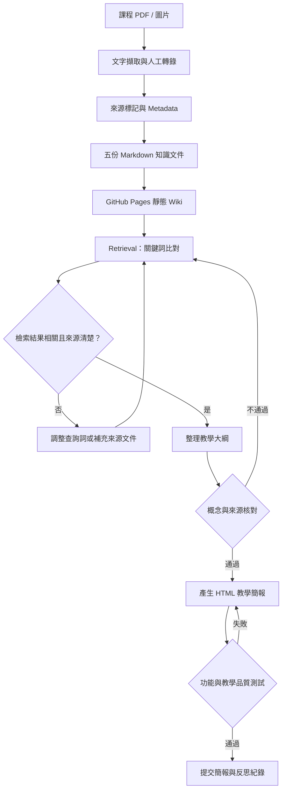

# Workflow / Graph 設計

## 節點責任

1. **資料擷取**：從課程 PDF、圖片取得原始文字；OCR 不確定處保留待核對。
2. **整理與 Metadata**：依主題拆成五份 Markdown，記錄來源、章節、狀態。
3. **Retrieval**：前端讀取 manifest 和來源文件，依查詢詞重疊找出片段。
4. **內容驗證**：核對每一項定義是否有來源支持，並辨識待核對內容。
5. **簡報生成**：只使用通過核對的片段；補充說明必須標示為教學例子或 AI 補充。
6. **測試**：檢查頁面操作、內容、來源註記與版面。

## 迴圈設計

- **Retrieval loop**：找不到相關內容時，改寫查詢或補充文件後重新檢索。
- **Verification loop**：定義或來源有疑義時，回到原始資料擷取與轉錄階段。
- **HTML loop**：互動或排版測試失敗時，修正 HTML 後重新測試。

## 技術限制

GitHub Pages 是靜態託管，這一版以瀏覽器端關鍵詞檢索作為可執行原型。它不會自動建立 embeddings，也不會自行呼叫 LLM。若作業必須展示語意向量檢索與 LLM 自動生成，需另外接後端服務；API 金鑰不得放在 GitHub 公開前端。
